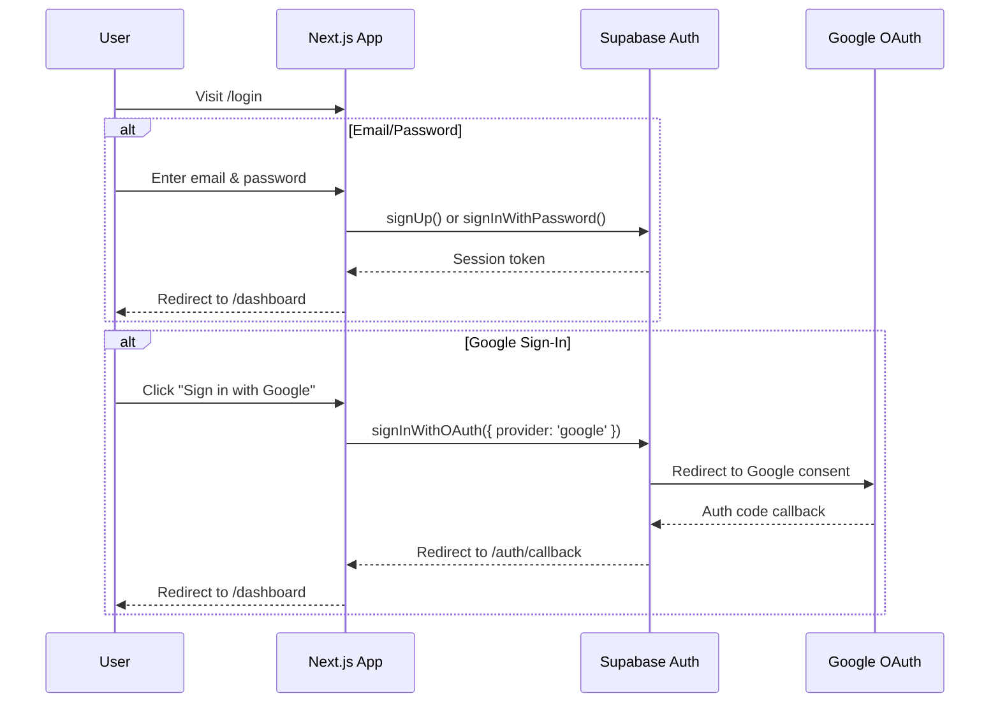

# 🔐 AuthFlow — Login & Registration Portal

A modern, premium login and registration website built with **Next.js**, **Supabase Auth**, and deployed on **Vercel**. Features both email/password authentication and Google OAuth sign-in with a stunning glassmorphic UI.

---

## ✨ Features

- **Email/Password Authentication** — Register and log in with traditional credentials
- **Google Sign-In** — One-click OAuth login via Google
- **Supabase Backend** — Managed PostgreSQL database with built-in auth
- **Responsive Design** — Looks great on desktop, tablet, and mobile
- **Premium UI** — Glassmorphism, smooth animations, and modern aesthetics
- **Vercel Deployment** — Instant, serverless deployment with CI/CD

---

## 🛠️ Tech Stack

| Layer        | Technology                     |
|--------------|-------------------------------|
| Framework    | Next.js 14 (App Router)       |
| Auth         | Supabase Auth                 |
| Database     | Supabase (PostgreSQL)         |
| Styling      | CSS Modules (Vanilla CSS)     |
| Deployment   | Vercel                        |
| Font         | Inter (Google Fonts)          |

---

## 📁 Project Structure

```
├── app/
│   ├── layout.js              # Root layout with metadata & fonts
│   ├── page.js                # Landing → redirects to /login
│   ├── globals.css            # Global design tokens & styles
│   ├── login/
│   │   ├── page.js            # Login & Registration page
│   │   └── login.module.css   # Login page styles
│   ├── dashboard/
│   │   └── page.js            # Post-login dashboard (protected)
│   └── auth/
│       └── callback/
│           └── route.js       # OAuth callback handler
├── lib/
│   └── supabase.js            # Supabase client initialization
├── .env.local                 # Environment variables (not committed)
├── package.json
├── next.config.js
└── README.md
```

---

## 🚀 Getting Started

### Prerequisites

- **Node.js** ≥ 18
- **npm** or **yarn**
- A **Supabase** project ([supabase.com](https://supabase.com))
- A **Google Cloud** OAuth client ([console.cloud.google.com](https://console.cloud.google.com))

### 1. Clone & Install

```bash
git clone <your-repo-url>
cd task-1
npm install
```

### 2. Configure Environment Variables

Create a `.env.local` file in the project root:

```env
NEXT_PUBLIC_SUPABASE_URL=https://your-project.supabase.co
NEXT_PUBLIC_SUPABASE_ANON_KEY=your-anon-key-here
```

### 3. Supabase Setup

1. Create a new project at [supabase.com](https://supabase.com)
2. Navigate to **Settings → API** to get your URL and anon key
3. Enable **Google Auth** under **Authentication → Providers → Google**
4. Add your Google OAuth Client ID and Client Secret
5. Set the redirect URI in Google Console to:
   ```
   https://<your-project-ref>.supabase.co/auth/v1/callback
   ```

### 4. Run Locally

```bash
npm run dev
```

Open [http://localhost:3000](http://localhost:3000) in your browser.

### 5. Deploy to Vercel

```bash
# Option A: Via Vercel CLI
npm i -g vercel
vercel

# Option B: Connect GitHub repo to Vercel Dashboard
# → vercel.com/new → Import your repository
```

> **Important:** Add your environment variables (`NEXT_PUBLIC_SUPABASE_URL` and `NEXT_PUBLIC_SUPABASE_ANON_KEY`) in the Vercel dashboard under **Settings → Environment Variables**.

---

## 🔒 Authentication Flow



---

## 📄 License

MIT License — feel free to use this project as a starting point for your own apps.
